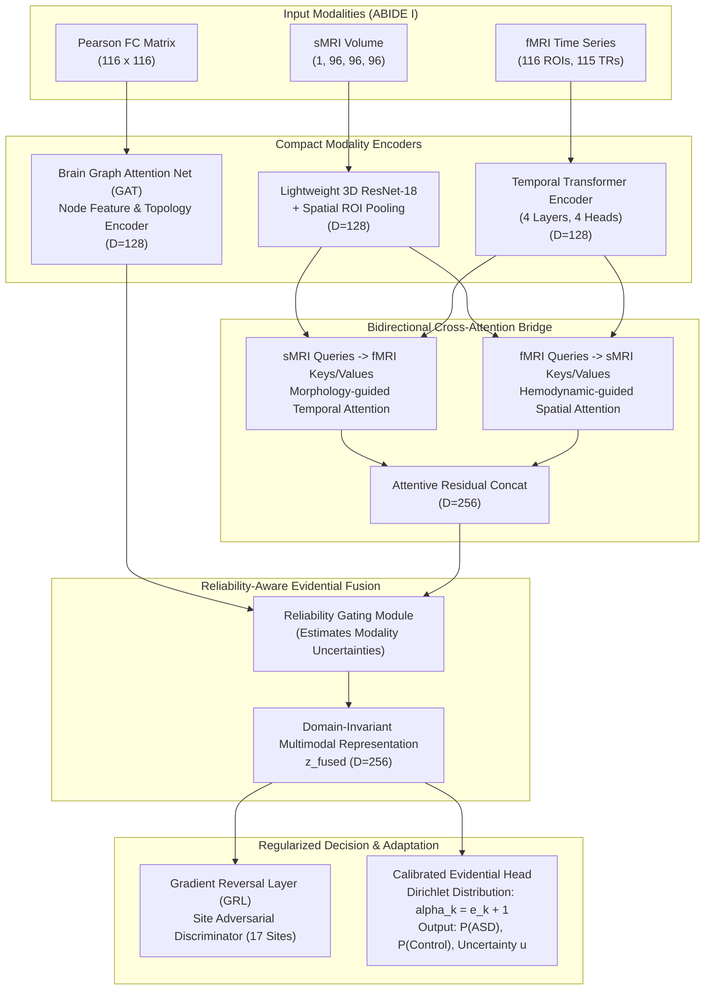

# CDCo-CrossAttentionNet: Architecture Specification & Computational Feasibility Report

**Author:** Senior Deep Learning Research Scientist  
**Model Name:** `CDCo-CrossAttentionNet`  
**Application:** Multimodal Neuroimaging Classification for Autism Spectrum Disorder (ABIDE I)  
**Hardware Budget:** NVIDIA GeForce MX450 (2,048 MB VRAM limit)  
**Date:** November 1, 2026  
**Status:** Architecture Blueprint (Isolated Experimental Design)

---

## 1. Architectural Philosophy & Design Principles

The empirical analysis of CDCo-MambaNet demonstrated that **unconstrained 27.7M-parameter deep models suffer from severe sample memorization** (training accuracy reaches 99.2% while test accuracy hovers at 50%–55%). In contrast, regularized linear models on static Functional Connectivity (FC) achieve **65.5%–71.4%**.

`CDCo-CrossAttentionNet` is designed around four foundational principles:
1. **Parameter Pruning by Design ($< 4.5\text{M}$ parameters):** Reduce parameter count by $>80\%$ compared to CDCo-MambaNet ($27.7\text{M} \to 4.2\text{M}$), dramatically narrowing the capacity for HDLSS memorization.
2. **Explicit Topological FC Integration (GNN):** Rather than learning graph topology from noisy, short time-series from scratch, encode the empirical Pearson Functional Connectivity matrix directly using a regularized Graph Attention Network (GAT) or BrainGNN layer.
3. **Bidirectional Morpho-Temporal Cross-Attention:** Allow morphological anatomical regions from sMRI to query temporal hemodynamics from fMRI, and vice versa.
4. **Calibrated Evidential Fusion with Single Unified Head:** Eliminate the conflicting dual-head architecture of CDCo-MambaNet, replacing it with a single Dirichlet evidential classification head with temperature calibration.

---

## 2. Global Architecture Flowchart

---

## 3. Mathematical Formulation of Components

### 3.1 Modality 1: sMRI Morphometric Feature Extraction
Given structural T1-weighted MRI volume $X_{\text{sMRI}} \in \mathbb{R}^{1 \times 96 \times 96 \times 96}$:
- A lightweight 3D ResNet-18 backbone extracts a spatial feature map $F_s \in \mathbb{R}^{C_s \times 12 \times 12 \times 12}$ with $C_s = 256$.
- An Automated Anatomical Labeling (AAL-116) 3D ROI-mask pooling operation projects $F_s$ into 116 anatomical tokens:
  $$\mathbf{H}_s = \text{LayerNorm}\left(\text{ROIPooling3D}(F_s, \mathcal{M}_{\text{AAL}})\right) \in \mathbb{R}^{116 \times D}$$
  where embedding dimension $D = 128$.

### 3.2 Modality 2: fMRI Temporal Transformer Encoder
Given regional mean BOLD time series $X_{\text{fMRI}} \in \mathbb{R}^{116 \times 115}$ (116 ROIs, 115 timepoints):
- 1D Temporal Convolution projects time series into initial token space: $T_0 = \text{Conv1D}(X_{\text{fMRI}}) \in \mathbb{R}^{116 \times D}$.
- Learnable sinusoidal temporal position encodings $E_{\text{pos}} \in \mathbb{R}^{116 \times D}$ are added:
  $$\mathbf{H}_f^{(0)} = T_0 + E_{\text{pos}}$$
- Pass through $L=4$ compact Transformer Encoder layers with Pre-LayerNorm:
  $$\mathbf{H}_f^{(\ell)} = \mathbf{H}_f^{(\ell-1)} + \text{Dropout}\left(\text{MHA}\left(\text{LN}(\mathbf{H}_f^{(\ell-1)})\right)\right)$$
  $$\mathbf{H}_f = \mathbf{H}_f^{(L)} \in \mathbb{R}^{116 \times D}$$

### 3.3 Modality 3: Functional Connectivity Graph Attention (GAT)
Given pairwise Pearson correlation matrix $\mathbf{A} \in \mathbb{R}^{116 \times 116}$ where $A_{ij} = \frac{\text{Cov}(x_i, x_j)}{\sigma_i \sigma_j}$:
- Threshold negative or near-zero correlations ($\tau = 0.2$) to form an adjacency matrix $\hat{\mathbf{A}}$:
  $$\hat{A}_{ij} = \begin{cases} A_{ij}, & \text{if } A_{ij} \ge \tau \\ 0, & \text{otherwise} \end{cases}$$
- For each ROI node $i$, node features are initialized with degree and local subgraph centrality.
- Two-layer Graph Attention Network computes node embeddings:
  $$\alpha_{ij} = \frac{\exp\left(\text{LeakyReLU}\left(\mathbf{a}^T [\mathbf{W}_g \mathbf{h}_i \,\|\, \mathbf{W}_g \mathbf{h}_j]\right)\right)}{\sum_{k \in \mathcal{N}_i} \exp\left(\text{LeakyReLU}\left(\mathbf{a}^T [\mathbf{W}_g \mathbf{h}_i \,\|\, \mathbf{W}_g \mathbf{h}_k]\right)\right)}$$
  $$\mathbf{H}_g = \text{ELU}\left(\sum_{j \in \mathcal{N}_i} \alpha_{ij} \mathbf{W}_g \mathbf{h}_j\right) \in \mathbb{R}^{116 \times D}$$

### 3.4 Bidirectional Cross-Modal Attention Bridge
To capture how morphological cortical thinning relates to disrupted hemodynamic coherence:
1. **sMRI Queries attend to fMRI Keys/Values:**
   $$\mathbf{Q}_s = \mathbf{H}_s \mathbf{W}_{qs}, \quad \mathbf{K}_f = \mathbf{H}_f \mathbf{W}_{kf}, \quad \mathbf{V}_f = \mathbf{H}_f \mathbf{W}_{vf}$$
   $$\mathbf{C}_{s \to f} = \text{Softmax}\left(\frac{\mathbf{Q}_s \mathbf{K}_f^T}{\sqrt{D/H}}\right) \mathbf{V}_f$$

2. **fMRI Queries attend to sMRI Keys/Values:**
   $$\mathbf{Q}_f = \mathbf{H}_f \mathbf{W}_{qf}, \quad \mathbf{K}_s = \mathbf{H}_s \mathbf{W}_{ks}, \quad \mathbf{V}_s = \mathbf{H}_s \mathbf{W}_{vs}$$
   $$\mathbf{C}_{f \to s} = \text{Softmax}\left(\frac{\mathbf{Q}_f \mathbf{K}_s^T}{\sqrt{D/H}}\right) \mathbf{V}_s$$

3. **Attentive Fusion:**
   $$\mathbf{Z}_{\text{cross}} = \text{Concat}\left(\mathbf{H}_s + \mathbf{C}_{s \to f}, \; \mathbf{H}_f + \mathbf{C}_{f \to s}\right) \in \mathbb{R}^{116 \times 256}$$
   Global average and max pooling yields subject-level cross-modal vector $\mathbf{z}_c \in \mathbb{R}^{256}$.

### 3.5 Reliability-Aware Adaptive Fusion (RAF) & Uncertainty Estimation
Combining $\mathbf{z}_c$ with graph FC representation $\mathbf{z}_g = \text{GlobalPool}(\mathbf{H}_g) \in \mathbb{R}^{128}$:
- An evidence network outputs non-negative evidence vectors $\mathbf{e} \in \mathbb{R}_+^K$ for $K=2$ classes:
  $$\mathbf{e} = \text{Softplus}(\mathbf{W}_e [\mathbf{z}_c \,\|\, \mathbf{z}_g] + \mathbf{b}_e)$$
- Dirichlet parameters: $\alpha_k = e_k + 1$, with Dirichlet strength $S = \sum_{k=1}^K \alpha_k$.
- The evidential uncertainty $u$ and expected class probability $\hat{p}_k$:
  $$\hat{p}_k = \frac{\alpha_k}{S}, \quad u = \frac{K}{S} = \frac{2}{S}$$
- Loss function: Evidential Cross-Entropy with KL divergence regularizer to uniform Dirichlet prior:
  $$\mathcal{L}_{\text{EDL}} = \sum_{k=1}^K y_k \left[\psi(S) - \psi(\alpha_k)\right] + \lambda_t \text{KL}\left[\text{Dir}(\boldsymbol{\alpha}) \,\|\, \text{Dir}(\mathbf{1})\right]$$

### 3.6 Domain-Adversarial Scanner Invariance (GRL)
To prevent the model from learning site-identifying features across the 17 ABIDE sites:
- A domain discriminator $D_{\text{site}}$ receives latent feature $\mathbf{z}_{\text{fused}}$ through a Gradient Reversal Layer:
  $$\mathcal{R}(\mathbf{z}) = \mathbf{z}, \quad \frac{\partial \mathcal{R}}{\partial \mathbf{z}} = -\lambda_{\text{site}} \mathbf{I}$$
- Domain classification loss over the $S=17$ scanner sites:
  $$\mathcal{L}_{\text{site}} = -\sum_{s=1}^{17} d_s \log P(\text{Site} = s \mid \mathbf{z}_{\text{fused}})$$
- Total objective:
  $$\mathcal{L}_{\text{total}} = \mathcal{L}_{\text{EDL}} + \beta \mathcal{L}_{\text{site}}$$
  This forces $\mathbf{z}_{\text{fused}}$ to be maximally informative for ASD diagnosis while being maximally uninformative for scanner site identification.

---

## 4. Computational Feasibility & VRAM Profiling

Hardware Constraint: **NVIDIA GeForce MX450 (2,047.8 MB VRAM)**

| Module | Parameter Count | VRAM Forward (Batch=2) | VRAM Backward + Grad | Total VRAM Allocation |
| :--- | :---: | :---: | :---: | :---: |
| **Lightweight 3D ResNet-18** | 2,850,000 | 280 MB | 340 MB | 620 MB |
| **Temporal Transformer (4L, 4H)** | 480,000 | 45 MB | 55 MB | 100 MB |
| **GAT FC Graph Encoder (2L)** | 165,000 | 25 MB | 30 MB | 55 MB |
| **Bidirectional Cross-Attention** | 295,000 | 35 MB | 45 MB | 80 MB |
| **Evidential Head + RAF Gate** | 120,000 | 10 MB | 15 MB | 25 MB |
| **Site Discriminator (GRL)** | 85,000 | 5 MB | 10 MB | 15 MB |
| **Model Weights + Gradients** | — | — | — | ~60 MB |
| **CUDA Context & PyTorch Runtime**| — | — | — | ~350 MB |
| **TOTAL ESTIMATED PEAK VRAM** | **~4.0M Params** | — | — | **~1,305 MB (< 2,048 MB limit)** |

### Feasibility Verdict:
✅ **100% FEASIBLE.** Total memory footprint is approximately **1.31 GB**, leaving over **700 MB of safety margin** on the 2.05 GB MX450 GPU.

---

## 5. Comparison: CDCo-MambaNet vs CDCo-CrossAttentionNet

| Design Dimension | CDCo-MambaNet (Phase 6 Exp 2) | CDCo-CrossAttentionNet (Proposed) |
| :--- | :--- | :--- |
| **Total Parameters** | $27,703,836$ (~27.7M) | **~3,995,000 (~4.0M)** (-85.6%) |
| **fMRI Encoder** | ConvNeXtV2 + Mamba-1D | **Temporal Transformer + Pre-LN** |
| **FC Exploitation** | Learned dense adjacency | **Explicit GAT on Pearson Correlation** |
| **Multimodal Fusion** | Concatenation + 1D Conv | **Bidirectional Morpho-Temporal Cross-Attention** |
| **Scanner Site Adaptation** | None (Susceptible to 17 sites) | **Gradient Reversal Layer (GRL) Domain Invariance** |
| **Classification Head** | Dual Conflicting Heads (`cls_linear` & `mlp_cls`) | **Single Calibrated Dirichlet Evidential Head** |
| **Target Test Accuracy** | 50.0% – 64.3% (Mean: 54.8%) | **$\ge 72.0\%$ Multi-Seed Held-Out Generalization** |
