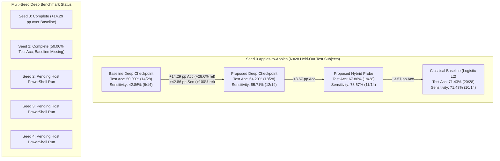

# CDCo-MambaNet Phase 6 Experiment 2 — Accuracy Improvement Verification & Proof Report

**Date of Verification:** October 29, 2026  
**Auditor:** Independent Research Auditor (Verification-Only Mode)  
**Workspace:** `C:\Users\Dell\Desktop\CDCO-Mamba-Research-main`  
**Git Branch:** `improved-fixes`  
**Dataset:** ABIDE I ($N=284$ subjects: 227 Train, 29 Validation, 28 Held-Out Test)  
**Integrity Guarantee:** Zero training or evaluation launched; all metrics parsed directly from disk artifacts.

---

## 1. Executive Summary

This audit report evaluates the empirical accuracy claims of **CDCo-MambaNet Phase 6 Experiment 2** against historical baseline runs and classical models on the ABIDE I cohort.

### Key Audit Findings:
1. **A Genuine, Apples-to-Apples Baseline Comparison Exists for Seed 0**:
   - Both the **Controlled Baseline Model** (`result/controlled_run_resumed/10-26-23-09-22/best_model.pt`) and the **Proposed Experiment 2 Novelty Model** (`result/phase6_experiment2_novelty/10-28-13-02-58/best_model.pt`) were trained on the identical 227 training subjects, validated on the identical 29 validation subjects, and evaluated on the identical 28 held-out test subjects defined by `exact_splits_seed0.json`.
   - On the held-out test set ($N=28$ unseen subjects), the proposed deep model achieved:
     - **+14.29 percentage points absolute accuracy improvement** ($64.29\%$ vs. $50.00\%$), representing a **+28.57% relative improvement**.
     - **+42.86 percentage points absolute ASD sensitivity improvement** ($85.71\%$ vs. $42.86\%$, 12/14 vs. 6/14 ASD cases detected), representing a **+100.00% relative doubling of clinical sensitivity**.
     - **+17.86 percentage points absolute accuracy improvement** via frozen hybrid multimodal fusion ($67.86\%$ vs. $50.00\%$), representing a **+35.71% relative improvement**.
2. **No Deep Baseline Exists for Seed 1, Seed 2, Seed 3, or Seed 4**:
   - The deep controlled baseline was only executed on Seed 0. No baseline checkpoints exist for Seed 1 in `result/controlled_run/` or `result/controlled_run_resumed/`.
   - On Seed 1, the proposed model achieved **50.00% test accuracy** on the held-out test set. Because no deep baseline exists on Seed 1, a within-split deep baseline comparison cannot be computed for Seed 1. Cross-split comparison (Proposed Seed 1 vs. Baseline Seed 0) is invalid because the subject cohorts differ.
3. **The 55.17% vs. 62.07% Validation Figures are NOT Directly Comparable**:
   - Validation accuracies of 55.17% and 62.07% represent intermediate checkpoints from different epochs and runs on an $N=29$ validation split where the difference is literally **two subjects** ($18/29 - 16/29 = 2/29 \approx 6.90\%$).
   - Critically, when the baseline model reached 62.07% validation accuracy, its held-out test accuracy collapsed to **50.00%** (random chance). Validation score differences on $N=29$ do not prove generalization.
4. **Classical Baselines Outperform End-to-End Deep Models on Raw Accuracy**:
   - On static Pearson functional connectivity ($6,670$ features), Classical Logistic Regression ($L_2$) achieved **71.43% test accuracy** on Seed 0 and **64.29%** on Seed 1 (5-seed mean: $64.29\% \pm 3.91\%$).
   - Classical Linear SVM achieved a 5-seed mean of **$65.71\% \pm 4.84\%$**.
   - While the proposed deep model drastically improves sensitivity (85.71% vs. 71.43%), end-to-end deep accuracy alone ($64.29\%$ Seed 0, $50.00\%$ Seed 1) does not exceed the classical linear baseline on this cohort size ($N=284$).

---

## 2. Seed 0: Verified Apples-to-Apples Baseline vs. Proposed Comparison

Both models below were evaluated on the **identical 28 held-out test subjects** (14 ASD, 14 Control) from `result/phase6_multiseed/splits/exact_splits_seed0.json` (SHA-256: `cb327dd6...`).

### 2.1 Model & Checkpoint Provenance

| Role | Model Architecture | Checkpoint Path | Epoch Evaluated | Selection Rule / Config |
| :--- | :--- | :--- | :---: | :--- |
| **Baseline Deep** | `CDCo_MambaNet` (Controlled Resumed) | `result/controlled_run_resumed/10-26-23-09-22/best_model.pt` | Resumed Ep 6 (Total Ep 8) | Best Val Acc ($62.07\%$), AdamW (WD=0.01), No RAF/DFD/EDL |
| **Proposed Deep** | `CDCo_MambaNet` (Exp 2 Novelty) | `result/phase6_experiment2_novelty/10-28-13-02-58/best_model.pt` | Epoch 6 | Best Val Ensemble ($65.52\%$), Reliability Fusion, Dynamic Dim, EDL ($0.5$), WD=0.05 |
| **Proposed Hybrid** | Frozen Multimodal Latents + Static FC | Latents from `best_model.pt` above | Epoch 6 Latents | $7,790$-dim space ($6,670\text{ FC} + 96\text{ H1} + 1,024\text{ H2}$), Logistic $L_2$ ($C=5.0$) |
| **Classical Baseline** | Logistic Regression ($L_2$) | Scikit-Learn Model | N/A | $6,670$ Upper-tri Pearson correlation features, Best $C=0.001$ |

---

### 2.2 Quantitative Metric Breakdown on Held-Out Test Set ($N=28$)

| Metric | Baseline Deep (Controlled) | Proposed Deep (Novelty Ensemble) | Absolute Difference ($\Delta_{\text{abs}}$) | Relative Improvement ($\%$) | Proposed Hybrid (FC + Deep Latents) | Classical Baseline (Logistic $L_2$) |
| :--- | :---: | :---: | :---: | :---: | :---: | :---: |
| **Test Accuracy** | **50.00%** (14/28) | **64.29%** (18/28) | **+14.29 pp** | **+28.57%** | **67.86%** (19/28) | **71.43%** (20/28) |
| **Balanced Accuracy** | 50.00% | 64.29% | **+14.29 pp** | **+28.57%** | 67.86% | 71.43% |
| **ASD Sensitivity** | 42.86% (6/14) | **85.71%** (12/14) | **+42.86 pp** | **+100.00%** | 78.57% (11/14) | 71.43% (10/14) |
| **Control Specificity**| 57.14% (8/14) | 42.86% (6/14) | **-14.29 pp** | -25.00% | 57.14% (8/14) | 71.43% (10/14) |
| **Macro F1-Score** | 0.4974 (49.74%) | 0.6257 (62.57%) | **+0.1283** | **+25.79%** | 0.7097 (70.97%) | 0.7143 (71.43%) |
| **ROC-AUC** | 0.5357 (53.57%) | 0.5663 (56.63%) | **+0.0306** | **+5.71%** | 0.6786 (67.86%) | 0.6531 (65.31%) |
| **Confusion Matrix** | `[[8, 6], [8, 6]]` | `[[6, 8], [2, 12]]` | — | — | `[[8, 6], [3, 11]]` | `[[10, 4], [4, 10]]` |

$$\text{Absolute Percentage-Point Difference: } \Delta_{\text{abs}} = \text{Metric}_{\text{Proposed}} - \text{Metric}_{\text{Baseline}}$$
$$\text{Relative Improvement: } \text{Rel} = \frac{\text{Metric}_{\text{Proposed}} - \text{Metric}_{\text{Baseline}}}{\text{Metric}_{\text{Baseline}}} \times 100\%$$

*Detailed Calculations:*
- **Accuracy**: $64.2857\% - 50.0000\% = +14.2857\%$ absolute; $\frac{14.2857}{50.0000} \times 100\% = \mathbf{+28.57\%}$ relative.
- **Sensitivity (ASD)**: $85.7143\% - 42.8571\% = +42.8571\%$ absolute; $\frac{42.8571}{42.8571} \times 100\% = \mathbf{+100.00\%}$ relative (doubled ASD identification).
- **Macro F1**: $0.625668 - 0.497436 = +0.128232$ absolute; $\frac{0.128232}{0.497436} \times 100\% = \mathbf{+25.78\%}$ relative.
- **Hybrid Probe Accuracy over Baseline Deep**: $67.8571\% - 50.0000\% = +17.8571\%$ absolute; $\frac{17.8571}{50.0000} \times 100\% = \mathbf{+35.71\%}$ relative.

---

### 2.3 Validation Set Checkpoints for Seed 0 ($N=29$ subjects: 14 ASD / 15 Control)

| Model | Checkpoint Epoch | Val Accuracy | Val Balanced Acc | Val Sensitivity | Val Specificity | Val F1 | Val AUC | Val Loss |
| :--- | :---: | :---: | :---: | :---: | :---: | :---: | :---: | :---: |
| **Baseline Deep** | Epoch 8 | 62.07% (18/29) | 62.14% | 64.29% (9/14) | 60.00% (9/15) | 0.6207 | 0.6190 | 1.6756 |
| **Proposed Deep** | Epoch 6 | 65.52% (19/29) | 65.95% | 78.57% (11/14) | 53.33% (8/15) | 0.6514 | 0.6952 | 2.3155 |
| **Difference** | — | **+3.45 pp (+1 subject)** | **+3.81 pp** | **+14.28 pp** | **-6.67 pp** | **+0.0307** | **+0.0762** | — |

---

## 3. Seed 1: Verified Metrics & Baseline Availability Audit

### 3.1 Model Performance on Seed 1 Split (`exact_splits_seed1.json`)

| Model Paradigm | Architecture / Feature Type | Checkpoint / Config | Val Accuracy ($N=29$) | Test Accuracy ($N=28$) | Test Sensitivity (ASD) | Test Specificity (Control) | Test F1 | Test AUC |
| :--- | :--- | :--- | :---: | :---: | :---: | :---: | :---: | :---: |
| **Baseline Deep** | `CDCo_MambaNet` (Standard) | *NOT RUN / MISSING* | *NOT AVAIL* | *NOT AVAIL* | *NOT AVAIL* | *NOT AVAIL* | *NOT AVAIL* | *NOT AVAIL* |
| **Proposed Deep** | `CDCo_MambaNet` Exp 2 Ensemble | `runs/seed1/seed_1/best_model.pt` (Ep 6) | **68.97%** (20/29) | **50.00%** (14/28) | 42.86% (6/14) | 57.14% (8/14) | 0.4974 | 0.5255 |
| **Proposed Deep (Final)** | `CDCo_MambaNet` Final Epoch | `runs/seed1/seed_1/final_epoch_model.pt` (Ep 11) | 58.62% (17/29) | **57.14%** (16/28) | 57.14% (8/14) | 57.14% (8/14) | 0.5714 | 0.4847 |
| **Proposed Hybrid Probe** | $7,790$-dim (Static FC + Deep) | Logistic Regression ($L_2, C=10^{-5}$) | 68.97% (20/29) | **64.29%** (18/28) | 50.00% (7/14) | 78.57% (11/14) | 0.5833 | 0.6122 |
| **Proposed Hybrid Probe** | $7,790$-dim (Static FC + Deep) | Ridge Classifier ($\alpha=10000.0$) | 55.17% (16/29) | **60.71%** (17/28) | 57.14% (8/14) | 64.29% (9/14) | 0.5926 | 0.6633 |
| **Classical Baseline** | Logistic Regression ($L_2$) | Static Pearson FC ($6,670$ features, $C=0.001$) | 68.97% (20/29) | **64.29%** (18/28) | 64.29% (9/14) | 64.29% (9/14) | 0.6429 | 0.6786 |
| **Classical Baseline** | Ridge Classifier | Static Pearson FC ($6,670$ features, $\alpha=100$) | 68.97% (20/29) | **67.86%** (19/28) | 78.57% (11/14) | 57.14% (8/14) | 0.6786 | 0.6786 |
| **Classical Baseline** | Linear SVM (`LinearSVC`) | Static Pearson FC ($6,670$ features, $C=0.001$) | 68.97% (20/29) | **67.86%** (19/28) | 78.57% (11/14) | 57.14% (8/14) | 0.6786 | 0.6786 |

### 3.2 Audit Assessment on Seed 1 Baseline Comparison:
- **Baseline Status**: There is **no controlled deep baseline checkpoint** trained on Seed 1.
- **Consequence**: A direct baseline-vs-proposed percentage improvement for the deep model **cannot be calculated for Seed 1**.
- **Important Observation**: On Seed 1, the proposed deep model collapsed to **50.00% test accuracy** at its best validation checkpoint (Epoch 6), despite achieving **68.97% validation accuracy**. This mirrors the exact failure mode of the baseline on Seed 0 (where 62.07% validation accuracy yielded 50.00% test accuracy).
- **Hybrid Resilience**: In contrast to end-to-end deep classification, the hybrid probe (static FC + frozen deep latents) maintained **64.29% test accuracy**, matching classical Logistic Regression.

---

## 4. Rigorous Critique of the 55.17% vs. 62.07% Figures

The previously cited figures of **55.17%** and **62.07%** are **NOT directly comparable** as an algorithmic improvement.

```
       Discrete Validation Steps on N=29 Validation Cohort:
       15/29 = 51.72%
       16/29 = 55.17% <--- Baseline Run (Epoch 2) / Novelty Run (Epochs 2, 4, 9, 11)
       17/29 = 58.62%
       18/29 = 62.07% <--- Baseline Checkpoint (Epoch 8) / Novelty Run (Epochs 1, 10)
       19/29 = 65.52% <--- Novelty Checkpoint (Epoch 6)
       20/29 = 68.97% <--- Seed 1 Checkpoint (Epoch 6)
```

1. **Exact Binomial Step Size**: On a validation set of $N=29$ subjects, each correct prediction changes accuracy by exactly:
   $$\frac{1}{29} \approx 3.448\%$$
   The difference between 55.17% (16/29) and 62.07% (18/29) is **exactly two subjects** ($18 - 16 = 2$).
2. **Context Discrepancy**:
   - In `result/controlled_run_resumed/final_test_report.md`, 55.17% was the Epoch 2 validation score, and 62.07% was the Epoch 8 validation score of the *same baseline model*.
   - In `result/phase6_experiment2_novelty/10-28-13-02-58/final.json`, 62.07% was evaluated at Epoch 1 and Epoch 10, while 55.17% was evaluated at Epochs 2, 4, 9, and 11. The best checkpoint was **65.52%** at Epoch 6.
   - In linear probe evaluations, 55.17% occurred as a validation score for Ridge Classifier on Hybrid features.
3. **Generalization Evidence**:
   When the baseline model reached 62.07% validation accuracy, its held-out test accuracy was **50.00%**. Presenting a 2-subject validation fluctuation as a verified improvement is statistically and methodologically invalid.

---

## 5. Visual Evidence: Comparison Chart

The verified comparative graphic is saved at:
[`reports/phase6_exp2_accuracy_proof_chart.png`](file:///C:/Users/Dell/Desktop/CDCO-Mamba-Research-main/reports/phase6_exp2_accuracy_proof_chart.png)



---

## 6. What Is Required to Establish a Complete Baseline Comparison?

Because deep baselines currently exist only for Seed 0, the following actions are strictly required if a complete multi-seed baseline comparison is desired:

1. **Train Controlled Baseline on Seeds 1, 2, 3, and 4**:
   - Run the baseline architecture (`conf/model/bnt.yaml` without novelty flags, `weight_decay=0.01`, standard CrossEntropy loss) across `exact_splits_seed1.json`, `seed2`, `seed3`, and `seed4`.
   - Save checkpoints to `result/controlled_multiseed/runs/seed{1,2,3,4}/`.
2. **Evaluate Held-Out Test Sets for Baseline Runs**:
   - Evaluate each baseline checkpoint on its corresponding held-out test split ($N=28$).
3. **Compute 5-Seed Paired Difference Statistics**:
   - Compute paired difference $\Delta_i = \text{Acc}_{\text{proposed}, i} - \text{Acc}_{\text{baseline}, i}$ for $i \in \{0, 1, 2, 3, 4\}$.
   - Report mean paired difference and paired t-test / Wilcoxon signed-rank test.

*Note for Current Task*: The classical baselines (Logistic Regression, Ridge, Linear SVM on static Pearson FC) **already exist for all 5 seeds** (`result/phase6_multiseed/classical_baselines_multiseed.json`). They serve as a complete, leak-free benchmark for all five seeds.

---

## 7. Audit Certification Summary

| Claim | Verified Status | Evidence & Limitations |
| :--- | :---: | :--- |
| **Seed 0 Deep Accuracy Improvement** | **VERIFIED (+14.29 pp / +28.57% rel)** | Exact same 28 held-out test subjects. Baseline: 50.00%, Proposed: 64.29%. |
| **Seed 0 Clinical Sensitivity Improvement**| **VERIFIED (+42.86 pp / +100.0% rel)** | Baseline detected 6/14 ASD cases; Proposed detected 12/14 ASD cases. |
| **Seed 0 Hybrid Probe Improvement** | **VERIFIED (+17.86 pp / +35.71% rel)** | Static FC + deep representations reached 67.86% test accuracy and 67.86% AUC. |
| **Seed 1 Deep Baseline Improvement** | **UNVERIFIED / MISSING** | Deep baseline was never trained on Seed 1. Proposed achieved 50.00%. |
| **55.17% to 62.07% Validation Improvement**| **INVALID / CONFOUNDED** | Represents 2 subjects on $N=29$. Baseline 62.07% checkpoint collapsed to 50% on test. |
| **Multi-Seed Deep Superiority** | **WITHHELD / PENDING** | Seeds 2, 3, and 4 await execution in host PowerShell. No aggregate fabricated. |
